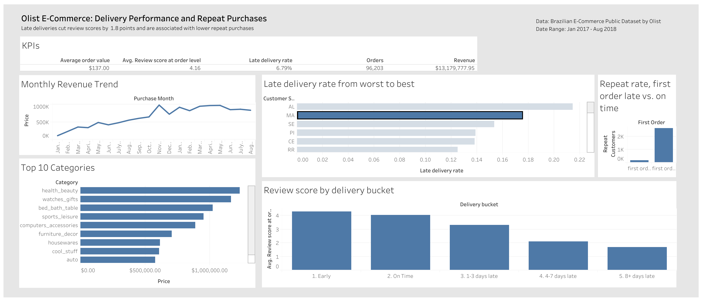

# sql-tableau-olist-ecommerce
SQL analysis and Tableau dashboard of Brazilian e-commerce sales, products, and repeat purchases

# Olist E-Commerce: Revenue, Delivery, and Repeat Purchases

**Business question:** An e-commerce manager wants to know which product categories, regions, and customer segments drive revenue and repeat purchases, and whether late deliveries hurt reviews and retention, so they can decide where to focus marketing and logistics.

**Dashboard:** [Dashboard Link](https://public.tableau.com/app/profile/steven.duong3978/viz/OlistE-CommerceDeliveryPerformanceandRepeatPurchases/Dash1)


**Data source:** 
- [Brazilian E-Commerce Public Dataset by Olist (Kaggle)](https://www.kaggle.com/datasets/olistbr/brazilian-ecommerce)
- Size: There are 9 related tables (orders, order items, customer, payment, reviews, products, sellers, geolocation, category translation), about 100k orders
- Analysis window: January 2017 to August 2018. Earlier months have few orders and add noise.

**Tools:** SQL (SQLite), Tableau Public, DB Browser, Python (Notebook, Pandas)

**Approach:**
- Loaded the 9 CSVs into a SQLite database through Python and mapped the join paths between tables
- Ran quality checks on the data: order status mix, date range, null delivery dates, and duplicate risks from orders with multiple items, payments, or reviews.
- Wrote 22 queries using CTEs, window functions (ROW_NUMBER, NTILE, running totals), and multi-table joins
- Built a reusable delivered view `delivered_orders` view for delivery and repeat purchase analysis
- Exported an item-level dataset and built an interactive Tableau dashboard

**Key Decisions**
- Revenue is `SUM(order_items.price)` for delivered orders only. `payment_value` is not used because orders can have multiple payment rows, which would double count
- Customers are identified by `customer_unique_id`. `customer_id` is unique per order, so it cannot measure repeat purchases
- An order is "late" if delivered after the estimated delivery date (compared by date, not timestamp)
- Reviews are collapsed to one score per order before joining because some orders have multiple reviews
- Cohort return rates use a 90-day window and only cohorts with a full 90 days of follow-up

**Key findings:**
- Revenue: Monthly revenue grew from $111798.36 in 2017-01 to $838576.64 in 2018-08, with a spike of $987765.37 in 2017-11
- Categorires and regions: The top 3 categories account for 25.92% of the total revenue. With the state of SP having generated $5055587.13 (38.36% of total revenue)
- Late deliveries: ~6.79% of delivered orders arrived after the estimated date. The worst states were AL, MA, and SE, at 21.46%, 17.53%, and 15.36% late, respectively.
- Reviews: Late orders averaged around 2.37 stars vs 4.17 for on-time or early orders. 53.7% of late orders received a 1-star review vs 6.57% for on-time orders. Reviews tend to be lower the longer the order is late.
- Repeat purchases: Only 3% of customers ordered more than once. Customers whose first orders was late reordered at 2.55% vs. 3.03% for those whose first order was delivered on time.
- Sellers: 118 sellers with 30+ orders had a late rate above 10%, with the highest at 32.56% and 43 orders.

**Recommendations:**
- Focus logistic fixes on the worst states by improving carrier options or setting more realistic estimated delivery time could potentially raise review scores.
- Monitor high-late-rate sellers by flagging them for review, warnings, lowering seller search placement, or even suspension.
- Follow up after a late first order. Late orders have lower repeat purchase rates, so an apology, voucher, or delivery update could be tested to see if there are any real effects.

**Limitations**
- Late delivery and repeat purchase link is an assocation, not proof of causation. Other factors like regions, item size, and seller quality could affect both variables.
- Reviews are always voluntary responses and not every order has one.
- Data only covers a small period of time, so the results may not reflect today's behaviour as technology and logistic strategies have changed.

**Repository Structure**
```
├── data/
│   ├── processed/      # SQLite database and exported CSVs
│   └── raw/            # Olist CSVs (not committed, see "How to reproduce")
├── images/             # Dashboard screenshot
├── notebooks/          # Data loading and sanity checks
├── sql/
│   ├── queries.sql         # Analysis queries with findings
│   └── schema_notes.md     # Join paths, data quality checks, decisions
├── tableau/            # Workbook and dashboard notes
├── README.md
└── requirements.txt        # To run Python libraries
```

**How to reproduce:**
1. Download the dataset from Kaggle into `data/raw/`
2. Install dependencies: `pip install -r requirements.txt`
3. Run `notebooks/01_load_data.ipynb` to build `data/processed/olist.db`
4. Run `sql/queries.sql in DB Browser
5. Select the queries in DB Browser and export them as CSVs to be used in Tableau

## Definition of Done
- [x] Olist tables loaded into SQLite
- [x] 10+ SQL queries with CTEs, window functions, and joins in `sql/queries.sql`
- [x] Late delivery vs. review score analysis
- [x] Repeat purchase analysis
- [x] Tableau dashboard: KPI row, 4-5 visuals
- [x] Live Tableau Public link and screenshot in README
- [x] Key findings and recommendations written